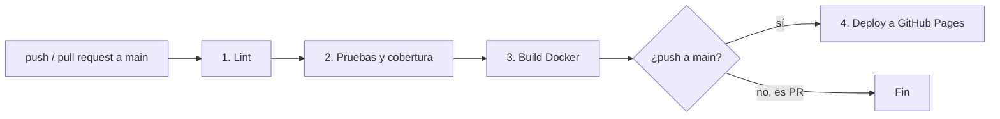

# Documentación del pipeline

Archivo: `.github/workflows/ci.yml` · Plataforma: GitHub Actions (runners `ubuntu-latest`)

## Diagrama

Cada etapa depende de la anterior (`needs`): si una falla, las siguientes no se ejecutan.

## Disparadores

| Evento | Qué ocurre |
|---|---|
| `push` a `main` | Etapas 1 a 4 (incluye despliegue) |
| `pull_request` hacia `main` | Etapas 1 a 3 (valida el cambio, **no** despliega) |
| `workflow_dispatch` | Ejecución manual desde la pestaña Actions |

También se usa `concurrency` para cancelar ejecuciones anteriores de la misma rama cuando se hacen *push* seguidos.

## Etapas

### 1. Lint
Descarga el código (`actions/checkout`), instala Node.js 20 (`actions/setup-node`) y ejecuta `npm run lint`, que valida la sintaxis de `src/app.js` y `src/server.js` con `node --check`. Es la etapa más rápida: detecta errores de escritura antes de gastar tiempo en pruebas.

### 2. Pruebas y cobertura
Ejecuta en este orden:

1. `npm run test:unit` — pruebas unitarias de cada endpoint.
2. `npm run test:integration` — flujos completos entre endpoints y el frontend estático.
3. `npm test` — todo junto con cobertura. Jest aplica el umbral de `package.json` (80 % sentencias/líneas/funciones, 70 % ramas); si no se cumple, la etapa falla.

Al final (aunque falle, gracias a `if: always()`) sube la carpeta `coverage/` como artefacto `reporte-cobertura` con 14 días de retención. Se descarga desde la página de la ejecución, sección *Artifacts*.

### 3. Build Docker
Construye la imagen con el `Dockerfile`, levanta el contenedor y consulta `GET /health` hasta 10 veces (cada 2 segundos). Verifica que la imagen no solo compila, sino que **arranca y responde**.

### 4. Despliegue a GitHub Pages
Solo corre si el evento es un `push` a `main` y las etapas 2 y 3 pasaron. Usa las acciones oficiales:

- `actions/configure-pages` — prepara el entorno de Pages.
- `actions/upload-pages-artifact` — empaqueta la carpeta `public/`.
- `actions/deploy-pages` — publica y devuelve la URL (visible en el *environment* `github-pages`).

Los permisos `pages: write` e `id-token: write` se otorgan **solo a este job**; el resto del workflow trabaja con `contents: read` (principio de mínimo privilegio).

## Cómo leer los resultados

- **Pestaña Actions** del repositorio: lista cada ejecución con ✅ / ❌.
- Al abrir una ejecución se ve el grafo de etapas y el log de cada paso.
- Una etapa en rojo muestra el paso exacto que falló y el mensaje de Jest o de Docker.

## Solución de problemas

| Síntoma | Causa probable | Solución |
|---|---|---|
| Falla `deploy-pages` con error 404 o "Pages not enabled" | No se activó Pages | Settings → Pages → Source: **GitHub Actions** |
| Falla "Resource not accessible by integration" | Permisos del workflow | Revisar `permissions` del job de despliegue |
| La etapa 2 falla por cobertura | Código nuevo sin pruebas | Agregar pruebas o revisar `coverage/lcov-report/index.html` |
| El health check de Docker no responde | El contenedor no arranca | Revisar `docker logs app` impreso al final del paso |
| El sitio muestra la versión anterior | Caché del navegador o despliegue pendiente | Recargar con Ctrl+F5 y verificar que la etapa 4 terminó |
